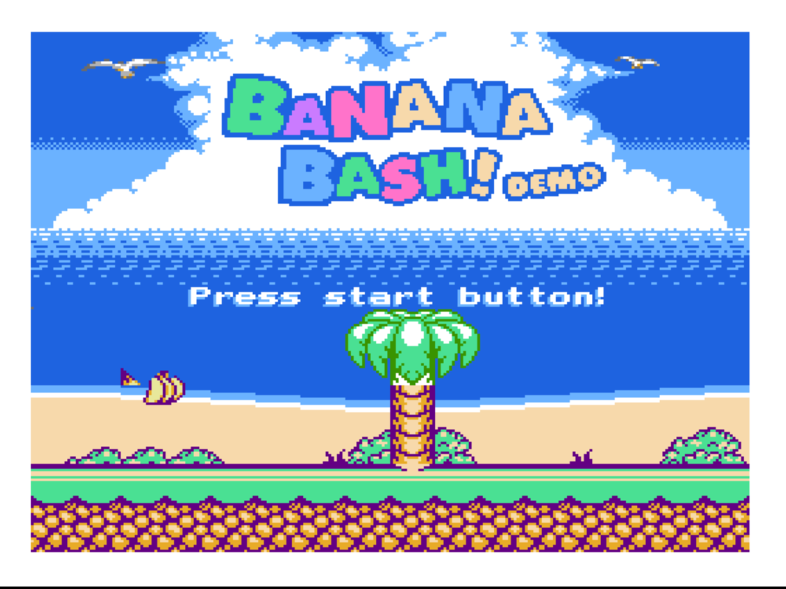
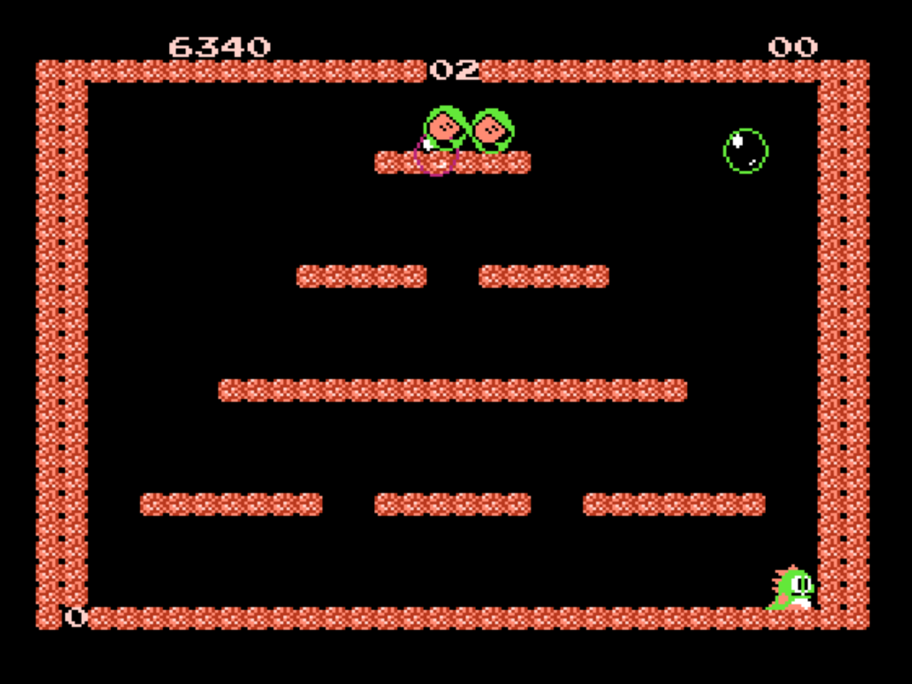
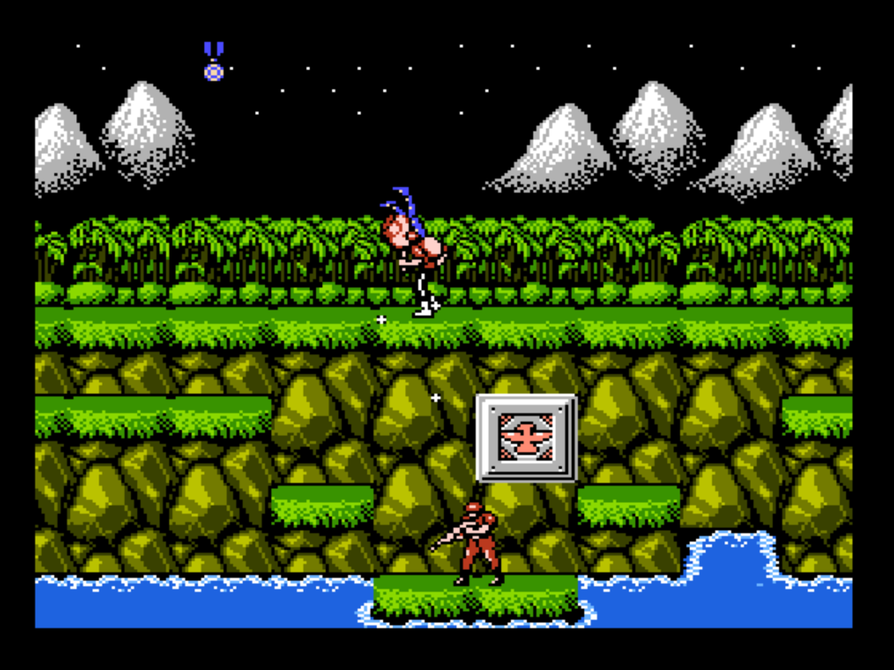
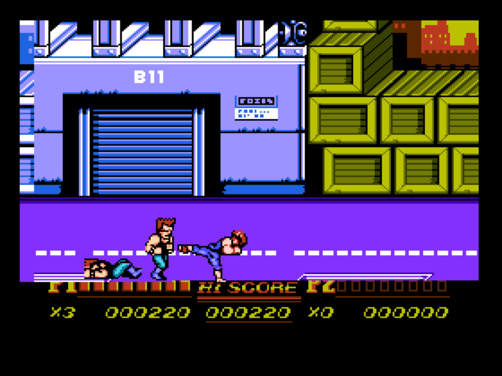
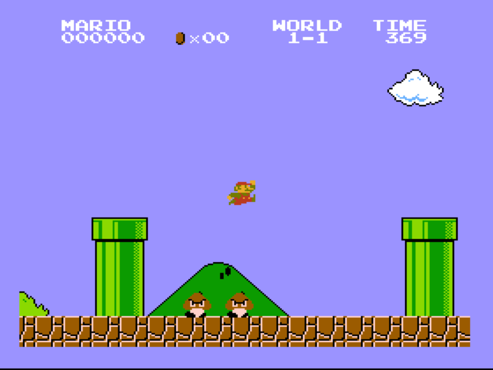
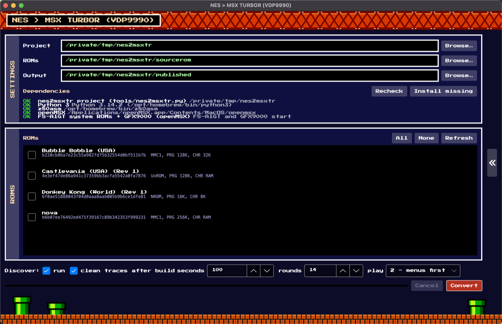

# nes2msxtr

**nes2msxtr** statically recompiles NES games into **MSX turboR** cartridges
that draw on a **V9990 (GFX9000)** and play through the PSG. The 6502 code is
traced and translated to Z80/R800 code ahead of time. A small runtime then
emulates the NES picture, sound and mapper on the MSX hardware.

> **Disclaimer**
>
> This project is a non-profit, fan-made unofficial port and is NOT
> affiliated with, authorized, maintained, sponsored, or endorsed by
> Nintendo Co., Ltd., Konami Group Corporation, Arc System Works Co., Ltd.,
> or any of their affiliates or subsidiaries.
>
> All registered trademarks, logos, game titles, characters, and related
> assets are the sole property of their respective owners (Super Mario Bros.:
> Nintendo; Contra: Konami; Double Dragon: Arc System Works). No copyright
> infringement is intended. This project is provided "as-is" for
> educational, preservation, and entertainment purposes only, and does not
> include or distribute copyrighted game ROMs or proprietary assets.
>
> Only use it on game images you own and have the right to convert.

## Quick start

Choose either route to convert and play a NES ROM on MSX turboR with a GFX9000
(V9990), using openMSX or real hardware. Both routes use the same project,
dependencies, and ROM folder.

Install dependencies once: `make deps`, or `tools\deps.cmd` on Windows. See
[Installing dependencies](#installing-dependencies).

### Command line (power users)

1. Copy your ROM into `sourcerom/`, for example `sourcerom/mygame.nes`.
2. Build it:
   ```sh
   make ROM=mygame
   ```
   This writes `build/mygame/mygame.rom` and `build/mygame/report.txt`. The
   report lists the mapper, RAM needed, code banks and translation warnings.
3. Play it in openMSX:
   ```sh
   make run ROM=mygame
   ```

`ROM` can be a name in `sourcerom/` (with or without `.nes`) or any path.
Some jump targets are found only while the game runs. If the game stops on one
(red backdrop), `make run` adds it to
`build/<game>/entries.<ROM-SHA1>.txt`; rebuild and play again. `make discover`
finds targets automatically by playing the game headless (see
[`samples/README.md`](samples/README.md)).

### Desktop app

1. Launch the app with `dotnet run --project app/Nes2MsxTr.App`, or use an
   [installer](app/README.md).
2. In **SETTINGS**, select the project folder and check that dependencies are
   installed. Put your ROM in the configured ROMs folder (default:
   `sourcerom/`).
3. Select the ROM and click **Convert**. When conversion finishes, click its
   **Play** button to run it in openMSX with the GFX9000.

To play on real MSX turboR hardware, copy the generated cartridge from
`published/` to the machine and run it with a GFX9000 attached.

A jump to an address the tracer never saw is handled by a small 6502
interpreter (`runtime/interp.asm`, one extra code bank). It runs the original
bytes until execution reaches translated code again. This is slow, so the path
still benefits from an entry target; `make discover` builds with `--no-interp`
to make unknown jumps visible as stops. `--no-interp` saves one 32K bank of
mapper RAM.

### Screenshots

| Banana Dash Demo | Bubble Bobble |
|---|---|
|  |  |

| Contra | Double Dragon II |
|---|---|
|  |  |

| Super Mario Bros. |
|---|
|  |

*Screenshots show tested builds running in openMSX on a Panasonic FS-A1GT
(R800) with a GFX9000.*

### Tested and supported ROMs

Hashes below are SHA-1 checksums of the complete `.nes` ROM images. Each
tested image has matching jump-target entries in [`samples/`](samples/).

| Game | SHA-1 (whole ROM) |
|---|---|
| Banana Dash Demo | `581be5540c4765a6275f44c8d791eedd26563f9e` |
| Bubble Bobble | `b220cb06a7e23c55a982fd75b32554d0bf511b7b` |
| Castlevania | `4e3ef47de86a941c37359bb3acfa5542a0fa7876` |
| Contra | `c9ea66bb7cb30ad5343f1721b1d4d3219859319b` |
| Donkey Kong Jr. | `25351a86888fb964f0ba57294e6ce64fa63b227c` |
| Double Dragon II | `457bf2438e11aa86947e5911c24f7075a9eceaeb` |
| DuckTales | `e2004d265e44e851f3c6053314af62a05fc4a595` |
| Excitebike | `8e807f8aa465891affc51939687009b36943aade` |
| Felix the Cat | `37fa1b70e63eca4f81681ffa7538e381d41020e4` |
| Guardian Legend | `9b763c36f0fcfb983083ca7b2fad4550dacd8dcb` |
| Gun.Smoke | `57daceeb93cb53c27661a02d8f8e8345b708b632` |
| Jackal | `c0067eb00e9f1f82561e9a96a5c2b7e22cee806c` |
| Kung Fu | `b36ece8fc8330c36716a7eb19874c31fc5f14287` |
| Maniac Mansion | `a421c563742f5f33bcf922b065ad5ed3d969977a` |
| Mega Man 2 | `54d53b46b961ba8b80ef57309bb0d78995d740a2` |
| Ninja Gaiden III | `6958358c4a554bdc6d4f8571f83829989d0bb018` |
| Pro Wrestling | `ac1a0ec1ae03355aa871657f309878bdb010b097` |
| Rampage | `f4bcdb31b2280469b4761067d4a30c0ddbb031f0` |
| Super Contra | `92fbbb836cc34ce16b80641b78d3a1254561cc48` |
| Super Mario Bros. 2 | `0dde824764daba70217e6167d01f202fb1666cb0` |
| Super Mario Bros. 3 | `a25d2dcbf6ec3634a84318bfe2cfe28d5331d815` |
| Toki | `8b37754e3a6cb732269fc8fb7151ec9b16153f4c` |
| Wacky Races | `b784f3f000574172ea78ed0ca5bcf18490cd7e3b` |
| Zombie Nation | `ea63840b39029b57e249be2a83624d0b9dc94ea7` |

### Not distributed or not yet verified

- **Not distributed:** Bubble Bobble, Contra, Double Dragon II, and Super
  Mario Bros. appear in screenshots, but their ROM images are not included.
- **Unverified:** Games and ROM revisions not listed as supported above.
- **Unsupported:** Games that require unsupported mappers or mapper modes.

## Supported NES mappers

| Mapper | Name | PRG | CHR | Notes |
|---|---|---|---|---|
| 0 | NROM | 16K / 32K | 8K ROM or RAM | Sprite-0 split screens |
| 1 | MMC1 | 16K banks at `$8000`, last one fixed (PRG mode 3), up to 256K | 8K RAM or up to 128K switched ROM | PRG RAM at `$6000` (up to 32K) |
| 2 | UxROM | 16K banks, the last one fixed | 8K RAM | |
| 4 | MMC3 | 8K banks at `$8000` / `$A000`, last 16K fixed (PRG mode 0) | 1K / 2K ROM banks, or 8K RAM | Scanline IRQ splits, `$A000` mirroring |

Not supported: other mappers, battery saves, MMC1 PRG modes other than 3 (and
SUROM, over 256K PRG), MMC3 PRG mode 1, and the DMC sound channel. See [docs/TECHNICAL.md](docs/TECHNICAL.md) for how
translation works and the full list of limits.

## What you need

To build:
- Python 3 and `make`
- [`z80asm`](https://www.nongnu.org/z80asm/)
- [cc65](https://cc65.github.io/), only to assemble the bundled test ROMs

To play:
- An MSX turboR (FS-A1ST or FS-A1GT) with a **GFX9000** (V9990 at I/O port
  `$60`).
- Enough RAM in one memory mapper for the game. `report.txt` gives the amount.
  The A1GT's internal 512K is enough for all three samples. Bigger games run
  from a RAM expansion cartridge, which the runtime finds at boot.
- Or [openMSX](https://openmsx.org/) with the FS-A1GT system ROMs. `make run`
  starts it with a GFX9000, and with a RAM expansion when the game needs one.

See [Installing dependencies](#installing-dependencies) for a script that
installs all of this.

## Installing dependencies

The scripts in `tools/` install the build tools and openMSX, then check that
openMSX can start an FS-A1GT with a GFX9000.

**macOS** (needs [Homebrew](https://brew.sh/)) **and Debian / Ubuntu** (apt,
asks for `sudo`):

```
make deps                  # or: tools/deps.sh
tools/deps.sh --check      # only report what is missing
```

On another Linux, `--check` lists what is missing; install it with your
package manager.

**Windows:** nes2msxtr runs in WSL (Windows Subsystem for Linux), since the
build uses `make` and shell scripts. WSL needs Windows 10 version 2004 or
later, or Windows 11. From a Command Prompt or PowerShell in the project
folder:

```
tools\deps.cmd                    # or: powershell -File tools\deps.ps1
tools\deps.cmd -Check             # only report what is missing
tools\deps.cmd -Distro Debian     # use another WSL distribution
```

1. The first run installs WSL with Ubuntu (it asks for administrator rights).
   Restart Windows if asked, finish the Ubuntu setup (user name and
   password), then run `tools\deps.cmd` again.
2. The second run installs the tools inside WSL with apt.
3. Build and play from WSL, for example `wsl make ROM=mygame` in the project
   folder. openMSX opens its window through WSLg.

**System ROMs (all platforms):** the FS-A1GT system ROMs are copyrighted, so
the scripts don't install them. Copy your own dumps into
`~/.openMSX/share/systemroms/` (inside WSL on Windows). The script reports
them missing until openMSX finds them.

**Choosing openMSX:** `make run` and the test scripts use the openMSX app in
`/Applications` if it is there, otherwise `openmsx` on the `PATH`. Set
`OPENMSX=/path/to/openmsx` to use another.

## Desktop app

`app/` has a small cross-platform front end (.NET 8, Avalonia) that makes the
conversion easier to manage. Instead of typing `make discover` and `make` for
each game, you tick the ROMs and press **Convert**.



*The app (Windows, Linux and macOS use the same window). This is a reference
screenshot; the paths and ROMs shown are only an example.*

- **SETTINGS** (top panel, click its tab to fold it): the project folder, the
  ROMs folder (`sourcerom/`), the output folder (`published/` by default) and a
  checklist of the dependencies: Python 3, z80asm, openMSX and the FS-A1GT
  system ROMs. **Install missing** installs what a package manager can
  (Homebrew, apt, winget); **Recheck** tests again.
- **ROMs**: every `*.nes` in the ROMs folder with its SHA-1 and mapper. Tick one
  or several. "published" marks a ROM already in the output folder, and a red
  "ready to fix (N)" marks one with crash traces saved in `build/<game>/`.
- **Convert**: for each ticked ROM it runs `tools/discover.py` (seconds, rounds
  and play mode are set below the list), then `tools/nes2msxtr.py`, copies the
  cartridge to the output folder, and, if "clean traces after build" is ticked,
  deletes the crash traces and openMSX dumps from `build/<game>/`.
- **LOG** (right, closed until something is logged): the output of every step,
  scrolling. Open or close it with the `«` / `»` button on the right edge.

Start it with `dotnet run --project app/Nes2MsxTr.App`. Steps for macOS, Linux
and Windows (WSL or native) and the single-file builds are in
[app/README.md](app/README.md).

### Installers

The installers carry the app and the project files (no ROMs). The app icon
is made from `assets/0-nes-to-msx-turbor.png` by `make icon`.

- **macOS**: build the disk image with
  ```
  make installer VERSION=1.3             # Apple silicon
  make installer VERSION=1.3 RID=osx-x64 # Intel
  ```
  It writes `dist/nes2msxtr-1.3-osx-arm64.dmg`. Open it and drag
  `nes2msxtr.app` to Applications. The first start copies the project to
  `~/nes2msxtr`, where your ROMs (`sourcerom/`) and the builds go. The app is
  not notarized: the first time, open it with right-click, **Open**.
- **Windows**: on Windows, with the .NET 8 SDK, Python 3 and Inno Setup 6
  (`winget install JRSoftware.InnoSetup`), run
  ```
  powershell -ExecutionPolicy Bypass -File installer\windows.ps1 1.3
  ```
  It writes `dist\nes2msxtr-1.3-win-x64-setup.exe`. The setup installs for
  the current user, without admin rights, into
  `%LOCALAPPDATA%\Programs\nes2msxtr`, adds a Start menu entry (a desktop
  shortcut is optional) and an uninstaller. Put your ROMs in its `sourcerom\`
  folder. SmartScreen may warn about the unsigned setup: **More info**, then
  **Run anyway**.

The dependencies (Python 3, z80asm, openMSX, the FS-A1GT system ROMs) are not
in the installers: use **Install missing** in the app, or see
[Installing dependencies](#installing-dependencies).

## Layout

```
nes2msxtr/
  sourcerom/      your NES ROM images (ignored by git, never distributed)
  samples/        jump targets found by playing the sample games
  build/<game>/   output: <game>.rom (ASCII16 megaROM), report.txt, ...
  tools/          translator (nes2msxtr.py, nestrace.py) and test tools
  app/            desktop front end (.NET 8): dependencies, ROM list, convert, log
  runtime/        Z80 runtime: PPU on the V9990, APU on the PSG, mappers
  testrom/        original test ROMs (NROM, UxROM, MMC3)
  docs/           technical notes and screenshots
```

## Controls

| NES | MSX keyboard | Joystick 1 |
|---|---|---|
| D-pad | cursor keys | stick |
| A | Z or SPACE | trigger A |
| B | X | trigger B |
| Start | RETURN | |
| Select | SELECT (F7 in openMSX) or TAB | |

## Other commands

```
make profile ROM=game     # play headless, rebuild with hot routines copied into
                          # the code banks that call them (repeat 2-3 times)
make replay ROM=game REPLAY=build/game/crash-1.omr
                          # replay a session saved on a crash (or F11)
make test                 # translate the test ROMs and compare their RAM with
                          # a reference 6502 run, in openMSX
make clean                # remove build/ (entries.txt included)
make deps                 # install the build tools and openMSX (tools/deps.sh)
make itch VERSION=1.3     # zip the tool (no ROMs) into dist/ for itch.io
```

Windows install, generating a ROM, the NROM happy path, and the
discover/crash/replay workflow for other mappers:
[docs/HOWTO_WINDOWS.md](docs/HOWTO_WINDOWS.md).

## How it works

In short: a recursive-descent tracer follows the code from the reset, NMI and
IRQ vectors. It finds jump tables, computed jumps and the bank mapped at each
call. Each instruction then becomes a few Z80 instructions, packed into 32K
code banks. NES background tiles become V9990 patterns, sprites a cached
V9990 sprite pattern table, the APU the PSG. Mapper writes go to a runtime
that keeps the PRG, CHR and mirroring state.

Details, design decisions and limits: [docs/TECHNICAL.md](docs/TECHNICAL.md).

## License

nes2msxtr is released under the [MIT License](LICENSE). The license covers the
tools, runtime, test ROMs, documentation and boot picture in this repository.
It does not cover NES game images or the cartridges built from them: those
hold code and graphics translated from the original game and belong to its
copyright holders. Don't distribute converted cartridges.

See the disclaimer at the top of this file. NES is a trademark of Nintendo;
MSX is a trademark of MSX Licensing Corporation.

---

## Contributing

Contributions are welcome!

- ⭐ **Star** this repo to help others discover it
- 🐛 **Report bugs** via [Issues](https://github.com/neurohide/nes2msxtr/issues)
- 💡 **Suggest features** via [Issues](https://github.com/neurohide/nes2msxtr/issues)

---

## Support

If the project is useful to you, consider supporting development:

[Buy Me a Coffee](https://buymeacoffee.com/neurohide)
