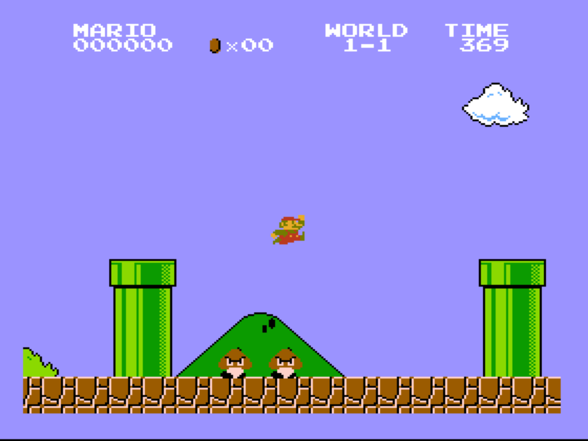
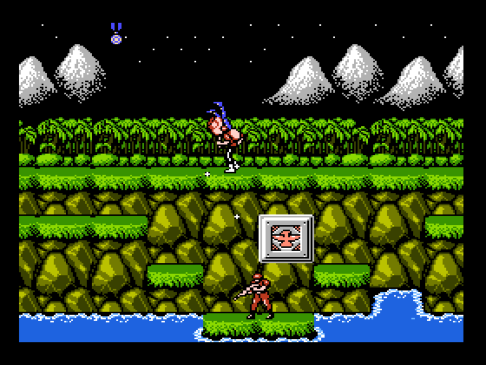
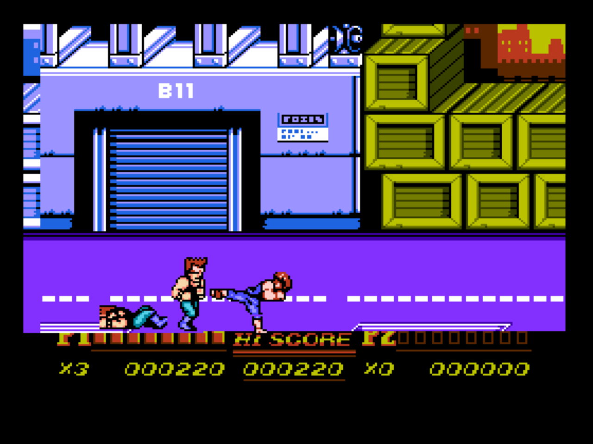

# nes2msxtr

**nes2msxtr** statically recompiles NES games into **MSX turboR** cartridges
that draw on a **V9990 (GFX9000)** and play through the PSG. The 6502 code is
traced and translated to Z80/R800 code ahead of time. A small runtime then
emulates the NES picture, sound and mapper on the MSX hardware.

> **Disclaimer**
>
> This project is a non-profit, fan-made unofficial port and is NOT
> affiliated with, authorized, maintained, sponsored, or endorsed by
> Nintendo Co., Ltd., Konami Group Corporation, Arc System Works Co., Ltd.,
> or any of their affiliates or subsidiaries.
>
> All registered trademarks, logos, game titles, characters, and related
> assets are the sole property of their respective owners (Super Mario Bros.:
> Nintendo; Contra: Konami; Double Dragon: Arc System Works). No copyright
> infringement is intended. This project is provided "as-is" for
> educational, preservation, and entertainment purposes only, and does not
> include or distribute copyrighted game ROMs or proprietary assets.
>
> Only use it on game images you own and have the right to convert.

| Super Mario Bros. | Contra | Double Dragon II: The Revenge |
|---|---|---|
|  |  |  |

*These screenshots are samples that show the result of the translation: the
cartridges nes2msxtr built from the ROMs listed below, running in openMSX on
a Panasonic FS-A1GT (R800) with a GFX9000.*

### ROMs tested

The samples were built and played from these images. Other dumps or
revisions of the same games may need other `entries.txt` targets or may not
work at all.

| File in `sourcerom/` | Game | Mapper | SHA-1 (whole `.nes` file) |
|---|---|---|---|
| `bananadashdemo.nes` | Banana Dash demo | 2 (UxROM) | `581be5540c4765a6275f44c8d791eedd26563f9e` |
| `contra.nes` | Contra (USA) | 2 (UxROM) | `c9ea66bb7cb30ad5343f1721b1d4d3219859319b` |
| `doubledragonii.nes` | Double Dragon II: The Revenge (USA) | 4 (MMC3) | `457bf2438e11aa86947e5911c24f7075a9eceaeb` |
| `nova.nes` | Nova | 1 (MMC1) | `b6b07ee76492ed475f39167c89b342353f999231` |
| `supermariobros.nes` | Super Mario Bros. (Japan, USA) | 0 (NROM) | `33d23c2f2cfa4c9efec87f7bc1321ce3ce6c89bd` |

Check yours with `shasum -a 1 sourcerom/*.nes`.

## Supported NES mappers

| Mapper | Name | PRG | CHR | Notes |
|---|---|---|---|---|
| 0 | NROM | 16K / 32K | 8K ROM or RAM | Sprite-0 split screens |
| 1 | MMC1 | 16K banks at `$8000`, last one fixed (PRG mode 3), up to 256K | 8K RAM | PRG RAM at `$6000` (up to 32K) |
| 2 | UxROM | 16K banks, the last one fixed | 8K RAM | |
| 4 | MMC3 | 8K banks at `$8000` / `$A000`, last 16K fixed (PRG mode 0) | 1K / 2K ROM banks, or 8K RAM | Scanline IRQ splits, `$A000` mirroring |

Not supported: other mappers, battery saves, MMC1 PRG modes other than 3 (and
SUROM, over 256K PRG), MMC3 PRG mode 1, and the DMC sound channel. See [docs/TECHNICAL.md](docs/TECHNICAL.md) for how
translation works and the full list of limits.

## What you need

To build:
- Python 3 and `make`
- [`z80asm`](https://www.nongnu.org/z80asm/)
- [cc65](https://cc65.github.io/), only to assemble the bundled test ROMs

To play:
- An MSX turboR (FS-A1ST or FS-A1GT) with a **GFX9000** (V9990 at I/O port
  `$60`).
- Enough RAM in one memory mapper for the game. `report.txt` gives the amount.
  The A1GT's internal 512K is enough for all three samples. Bigger games run
  from a RAM expansion cartridge, which the runtime finds at boot.
- Or [openMSX](https://openmsx.org/) with the FS-A1GT system ROMs. `make run`
  starts it with a GFX9000, and with a RAM expansion when the game needs one.

See [Installing dependencies](#installing-dependencies) for a script that
installs all of this.

## Installing dependencies

The scripts in `tools/` install the build tools and openMSX, then check that
openMSX can start an FS-A1GT with a GFX9000.

**macOS** (needs [Homebrew](https://brew.sh/)) **and Debian / Ubuntu** (apt,
asks for `sudo`):

```
make deps                  # or: tools/deps.sh
tools/deps.sh --check      # only report what is missing
```

On another Linux, `--check` lists what is missing; install it with your
package manager.

**Windows:** nes2msxtr runs in WSL (Windows Subsystem for Linux), since the
build uses `make` and shell scripts. WSL needs Windows 10 version 2004 or
later, or Windows 11. From a Command Prompt or PowerShell in the project
folder:

```
tools\deps.cmd                    # or: powershell -File tools\deps.ps1
tools\deps.cmd -Check             # only report what is missing
tools\deps.cmd -Distro Debian     # use another WSL distribution
```

1. The first run installs WSL with Ubuntu (it asks for administrator rights).
   Restart Windows if asked, finish the Ubuntu setup (user name and
   password), then run `tools\deps.cmd` again.
2. The second run installs the tools inside WSL with apt.
3. Build and play from WSL, for example `wsl make ROM=mygame` in the project
   folder. openMSX opens its window through WSLg.

**System ROMs (all platforms):** the FS-A1GT system ROMs are copyrighted, so
the scripts don't install them. Copy your own dumps into
`~/.openMSX/share/systemroms/` (inside WSL on Windows). The script reports
them missing until openMSX finds them.

**Choosing openMSX:** `make run` and the test scripts use the openMSX app in
`/Applications` if it is there, otherwise `openmsx` on the `PATH`. Set
`OPENMSX=/path/to/openmsx` to use another.

## Layout

```
nes2msxtr/
  sourcerom/      your NES ROM images (ignored by git, never distributed)
  samples/        jump targets found by playing the sample games
  build/<game>/   output: <game>.rom (ASCII16 megaROM), report.txt, ...
  tools/          translator (nes2msxtr.py, nestrace.py) and test tools
  runtime/        Z80 runtime: PPU on the V9990, APU on the PSG, mappers
  testrom/        original test ROMs (NROM, UxROM, MMC3)
  docs/           technical notes and screenshots
```

## Quick start

1. Install the dependencies (once): `make deps`, or `tools\deps.cmd` on
   Windows. See [Installing dependencies](#installing-dependencies).
2. Copy your ROM into `sourcerom/`, for example `sourcerom/mygame.nes`.
3. Build it:
   ```
   make ROM=mygame
   ```
   This writes `build/mygame/mygame.rom` and `build/mygame/report.txt`. The
   report lists the mapper, RAM needed, code banks and translation warnings.
4. Play it in openMSX:
   ```
   make run ROM=mygame
   ```

`ROM` can be a name in `sourcerom/` (with or without `.nes`) or any path.
Some jump targets can only be found while the game runs. When the game stops
on one (red backdrop), `make run` adds it to `build/<game>/entries.txt`;
rebuild and play on. `make discover` finds them headless by playing the game
automatically (see the samples below).

## Sample games

Put your own dumps in `sourcerom/` under these names, then build all of them:

```
make samples
```

The jump targets found so far by playing (`samples/<game>.entries.txt`) are
copied into `build/<game>/` the first time a sample is built.

### Banana Dash demo

`sourcerom/bananadashdemo.nes`, Banana Dash demo. UxROM, 512K PRG, CHR RAM.
Needs 848K of RAM (a RAM expansion).

```
make ROM=bananadashdemo
make run ROM=bananadashdemo
make discover ROM=bananadashdemo DISCOVER_PLAY=2 DISCOVER_SECS=120
```

Calls from the fixed bank into the switchable half go through the run-time
lookup, so many jump targets only show up in play (`samples/` has 44).
Headless play doesn't get into the first level; play it with `make run`.

### Nova

`sourcerom/nova.nes`, Nova. MMC1, 256K PRG, CHR RAM, 32K PRG RAM. Needs 720K
of RAM (a RAM expansion).

```
make ROM=nova
make run ROM=nova
make discover ROM=nova
```

The jump targets found so far are in `samples/nova.entries.txt`.

### Super Mario Bros.

`sourcerom/supermariobros.nes`, Super Mario Bros. (Japan, USA). NROM, 32K
PRG, 8K CHR ROM. Needs 240K of RAM.

```
make ROM=supermariobros
make run ROM=supermariobros
make discover ROM=supermariobros
```

Uses the sprite-0 split for the status bar. The attract mode and normal play
run without stops.

### Contra

`sourcerom/contra.nes`, Contra (USA). UxROM, 128K PRG, CHR RAM. Needs 368K
of RAM.

```
make ROM=contra
make run ROM=contra
# headless discovery on all 8 stages with 9 lives
# (NES RAM $32 = lives, $30 = stage)
make discover ROM=contra DISCOVER_SECS=100 \
  DISCOVER_POKES="32=09,30=00;32=09,30=01;32=09,30=02;32=09,30=03;32=09,30=04;32=09,30=05;32=09,30=06;32=09,30=07"
```

### Double Dragon II: The Revenge

`sourcerom/doubledragonii.nes`, Double Dragon II (USA). MMC3, 128K PRG,
128K CHR ROM. Needs 432K of RAM. The CHR ROM stays in the cartridge and is
read from there when the game switches banks.

```
make ROM=doubledragonii
make run ROM=doubledragonii
# headless discovery: presses Start through the intro and menus
# (DISCOVER_PLAY=2), infinite lives ($0432) on each difficulty ($0422)
make discover ROM=doubledragonii DISCOVER_PLAY=2 DISCOVER_SECS=240 \
  DISCOVER_POKES="432=09;432=09,422=01;432=09,422=02"
```

Uses scanline IRQ splits for the status bar, CHR banks for the screen
graphics and a lag-frame model: when the main loop is late, the NMI waits
for it. The game then slows down instead of showing half-built frames.
Automated play reaches the end of mission 1. Later missions are reached only
by playing.

## Controls

| NES | MSX keyboard | Joystick 1 |
|---|---|---|
| D-pad | cursor keys | stick |
| A | Z or SPACE | trigger A |
| B | X | trigger B |
| Start | RETURN | |
| Select | SELECT | |

## Other commands

```
make profile ROM=game     # play headless, rebuild with hot routines copied into
                          # the code banks that call them (repeat 2-3 times)
make replay ROM=game REPLAY=build/game/crash-1.omr
                          # replay a session saved on a crash (or F11)
make test                 # translate the test ROMs and compare their RAM with
                          # a reference 6502 run, in openMSX
make clean                # remove build/ (entries.txt included)
make deps                 # install the build tools and openMSX (tools/deps.sh)
```

## How it works

In short: a recursive-descent tracer follows the code from the reset, NMI and
IRQ vectors. It finds jump tables, computed jumps and the bank mapped at each
call. Each instruction then becomes a few Z80 instructions, packed into 32K
code banks. NES background tiles become V9990 patterns, sprites a cached
V9990 sprite pattern table, the APU the PSG. Mapper writes go to a runtime
that keeps the PRG, CHR and mirroring state.

Details, design decisions and limits: [docs/TECHNICAL.md](docs/TECHNICAL.md).

## License

nes2msxtr is released under the [MIT License](LICENSE). The license covers the
tools, runtime, test ROMs, documentation and boot picture in this repository.
It does not cover NES game images or the cartridges built from them: those
hold code and graphics translated from the original game and belong to its
copyright holders. Don't distribute converted cartridges.

See the disclaimer at the top of this file. NES is a trademark of Nintendo;
MSX is a trademark of MSX Licensing Corporation.
