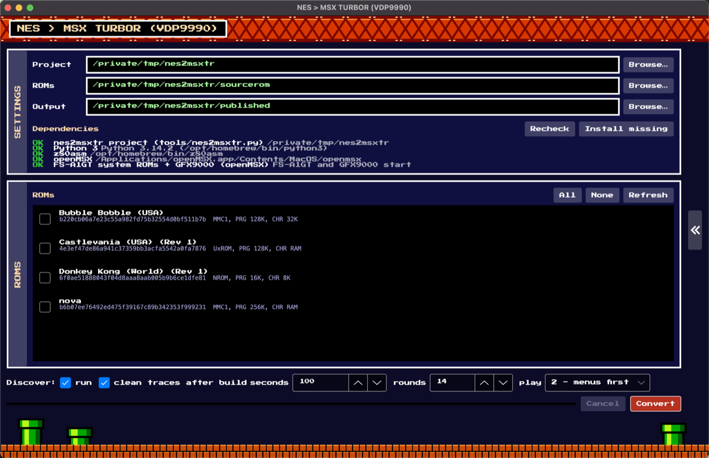

# nes2msxtr app

A desktop front end for the converter (.NET 8 and Avalonia, one code base for
Windows, Linux and macOS). It does what `make discover` and `make` do, for
several ROMs at once:

- **Settings** panel: the project folder, the ROMs folder, the output folder
  (default `published/`) and a checklist of the dependencies (Python 3, z80asm,
  openMSX, the FS-A1GT system ROMs). **Install missing** uses Homebrew, apt or
  winget.
- **ROMs** panel: every `*.nes` in the ROMs folder with its SHA-1 and mapper.
  Tick one or more. "published" marks a ROM already in the output folder, and a
  red "ready to fix (N)" marks one with crash traces in `build/<game>/`.
- **Convert**: for each ticked ROM it runs `tools/discover.py`, then
  `tools/nes2msxtr.py`, then copies `<name>.rom` to the output folder. It can
  clean the crash traces and openMSX dumps afterwards.
- **Log** (right, closed until something is logged): open and close it with
  the `«` / `»` button on the right edge.

The app only drives the Python tools, so it must find the project folder
(the one with `tools/` and `runtime/`). It looks from its own folder and from
the folder you start it in; otherwise use **Browse** next to Project.

The FS-A1GT system ROMs are copyrighted and are not installed by anything:
copy your own dumps into openMSX's `systemroms` folder.

## Run it

### Any system, from source

Needs the [.NET 8 SDK](https://dotnet.microsoft.com/download/dotnet/8.0).

    dotnet run --project app/Nes2MsxTr.App

### macOS

1. Install [Homebrew](https://brew.sh/) and the .NET 8 SDK
   (`brew install --cask dotnet-sdk`), or use a published build.
2. Published build:

       dotnet publish app/Nes2MsxTr.App -c Release -r osx-arm64 -o dist/app-osx-arm64   # Apple silicon
       dotnet publish app/Nes2MsxTr.App -c Release -r osx-x64   -o dist/app-osx-x64     # Intel
       dist/app-osx-arm64/nes2msxtr-app

   Keep the `.dylib` files next to the executable. If macOS refuses to open a
   build you copied from elsewhere: `xattr -dr com.apple.quarantine dist/app-osx-arm64`.
3. **Install missing** runs `brew install python3 z80asm openmsx`.

### Linux

1. Install the .NET 8 SDK (or use a published build) and, for the window,
   a desktop session (X11 or Wayland with XWayland).
2. Published build:

       dotnet publish app/Nes2MsxTr.App -c Release -r linux-x64 -o dist/app-linux-x64
       chmod +x dist/app-linux-x64/nes2msxtr-app
       dist/app-linux-x64/nes2msxtr-app

3. **Install missing** runs `apt-get install -y python3 z80asm openmsx` through
   `pkexec` or `sudo -n`. If neither can ask for a password, run that command
   in a terminal and press **Recheck**. On other distributions install
   Python 3, z80asm and openMSX with the package manager.

### Windows

z80asm has no Windows package, and the project's shell scripts expect a
Linux shell. Two ways:

- **Recommended: run the Linux build inside WSL.**
  1. In PowerShell: `wsl --install` (restart if asked), then open Ubuntu.
  2. Inside Ubuntu: install the .NET 8 SDK, then follow the Linux steps
     above. Windows 11 and recent Windows 10 show the window through WSLg.
  3. Put your project and ROMs under the Linux home (`~/nes2msxtr`), not
     `/mnt/c`, for speed. Copy the FS-A1GT ROM dumps into
     `~/.openMSX/share/systemroms/`.
- **Native:**

      dotnet publish app/Nes2MsxTr.App -c Release -r win-x64 -o dist\app-win-x64
      dist\app-win-x64\nes2msxtr-app.exe

  **Install missing** uses winget for Python 3 and openMSX. You must provide
  z80asm yourself (build it from savannah.nongnu.org/projects/z80asm and put it
  on PATH). Windows SmartScreen may warn about an unsigned build: More info,
  then Run anyway.

## Build the release files

    dotnet publish app/Nes2MsxTr.App -c Release -r <rid> -o dist/app-<rid>

with `<rid>` one of `win-x64`, `linux-x64`, `osx-arm64`, `osx-x64`. Each
output is self-contained (no .NET needed to run it). On Windows and Linux the
native libraries are packed into the single executable; on macOS the `.dylib`
files stay beside it.

## Installers

The icon is made from `assets/0-nes-to-msx-turbor.png` (the artwork left of
the NOTICE panel, without the text above and below it) by `make icon` (`tools/make_icon.py`); it writes
`Assets/icon.png`, `installer/icon.ico` and `installer/icon.icns`.

- **macOS**: `make installer VERSION=1.3` (add `RID=osx-x64` for Intel) writes
  `dist/nes2msxtr-1.3-osx-arm64.dmg`: drag `nes2msxtr.app` to Applications.
  The project ships inside the app; the first start copies it to
  `~/nes2msxtr`, where the ROMs and the builds go. The app is signed ad hoc
  only, so the first time open it with right-click, Open.
- **Windows** (on Windows, with the .NET 8 SDK, Python 3 and Inno Setup 6:
  `winget install JRSoftware.InnoSetup`):

      powershell -ExecutionPolicy Bypass -File installer\windows.ps1 1.3

  writes `dist\nes2msxtr-1.3-win-x64-setup.exe`. It installs for the current
  user, without admin rights, into `%LOCALAPPDATA%\Programs\nes2msxtr`, with
  a Start menu entry (and optionally a desktop one) and an uninstaller.
